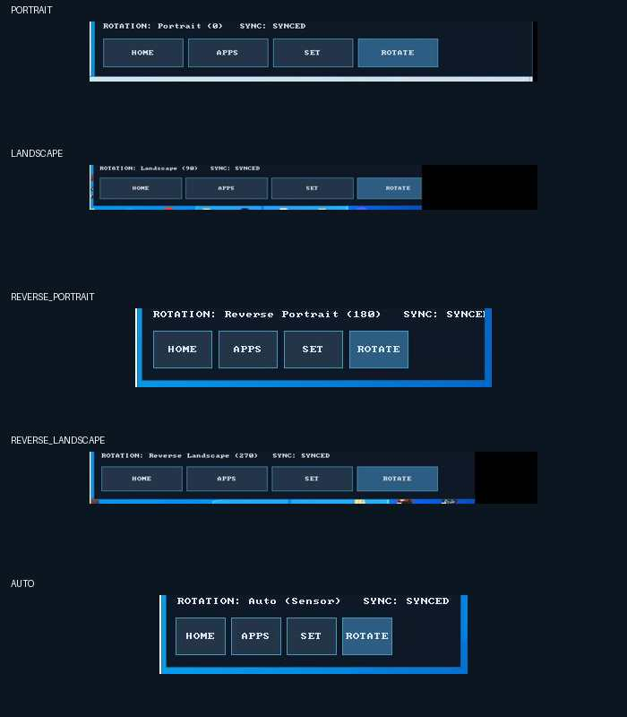

# Rotation synchronization QA — 22 November 2026

Repository: `nellyd95/scrcpy` · Branch: `Contribute`

## Test system

- Windows 10 Admin PC; local clean-source checkout on `D:` and build output on `T:`
- MSYS2 UCRT64, GCC 16.2.0, SDL3 3.4.20, Meson 1.12.1, Ninja 1.13.2
- Android server built using JDK 17 and Android API 35 build tools
- Motorola Moto G 5G (2024), Android 15, via USB ADB (`ZN32242JK2`)
- Client video decoding: Direct3D11 hardware acceleration

## End-to-end five-mode ROTATE button test

| Button preset | Android physical display rotation | `wm user-rotation` | Fixed-to-user policy | Sensor setting | UI result |
| --- | --- | --- | --- | --- | --- |
| Portrait | 0° | `lock 0` | `enabled` | `0` | **SYNCED** |
| Landscape | 90° | `lock 1` | `enabled` | `0` | **SYNCED** |
| Reverse Portrait | 180° | `lock 2` | `enabled` | `0` | **SYNCED** |
| Reverse Landscape | 270° | `lock 3` | `enabled` | `0` | **SYNCED** |
| Auto (Sensor) | Returns to device-controlled orientation | `free` | `disabled` | `1` | **SYNCED** |

**All five successive ROTATE-button clicks were verified on the real device.**
The scrcpy window and decoded stream switched aspect ratios between portrait
and landscape. Reverse portrait/landscape were verified using Android's
authoritative reported display rotation rather than relying on frame dimensions.

The image above contains only scrcpy's status/control footer; no personal
phone-screen content was added to the public repository.

## Root cause and repair

The Motorola firmware accepted a user rotation lock but did not actually
turn the display while its fixed-to-user-rotation policy was in default mode.
Temporarily setting that policy to `enabled` made all four forced rotations
apply immediately. The Android shell query also exposed a compatibility
issue: `getFixedToUserRotation(int)` is not published on this device's
`IWindowManager$Stub$Proxy`, so the server must read it through Android's
platform `cmd window fixed-to-user-rotation` command.

Auto mode must both release the rotation lock and enable the sensor:
`cmd window user-rotation -d 0 free` plus
`cmd settings put system accelerometer_rotation 1`.
Using the binder thaw method alone did not reliably leave the system in
sensor-controlled mode on this phone.

The server saves the initial frozen/free state, rotation angle, fixed policy
and accelerometer value before taking control. After a normal scrcpy exit,
Android was rechecked and matched its initial configuration:
`lock 0`, `default`, `accelerometer_rotation=0`.

## Startup and regression tests

- After relaunch with the device locked at 0°, the UI showed
  **Portrait (0) — SYNCED** without any manual request.
- The C state machine now adopts initial and external confirmed modes
  and tracks outstanding local requests without prematurely acknowledging them.
- The Windows executable rebuilt successfully; **14/14 Meson suites passed**.
- External Android rotation-lock changes were tested while the device stayed
  at physical rotation 0: switching `lock 0` to `free` and back to `lock 0`
  produced distinct Android server events (`frozen=true`, `false`, `true`).
  The server now polls both the rotation and frozen flag at 750 ms intervals
  and sends only changes, complementing DisplayMonitor callbacks.
- The Android server was compiled successfully and pushed through the
  existing USB-connected scrcpy QA session.
- Source files and build artifacts remain on `D:` and `T:`; no wireless
  ADB access was initiated.

## Validation boundaries

These results verify the five state transitions on this specific phone.
Physical handset motion during sensor-driven Auto mode was not independently
performed during remote QA. Other Android vendors, older OS versions,
unexpected process termination and simultaneous external changes to rotation
policy still warrant broader regression testing.
